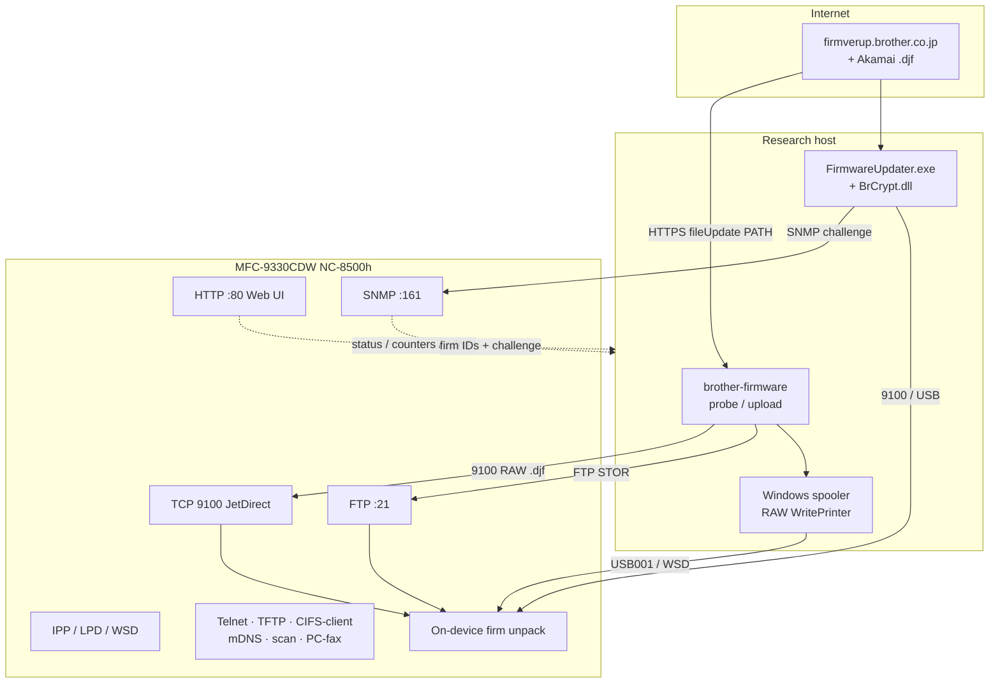
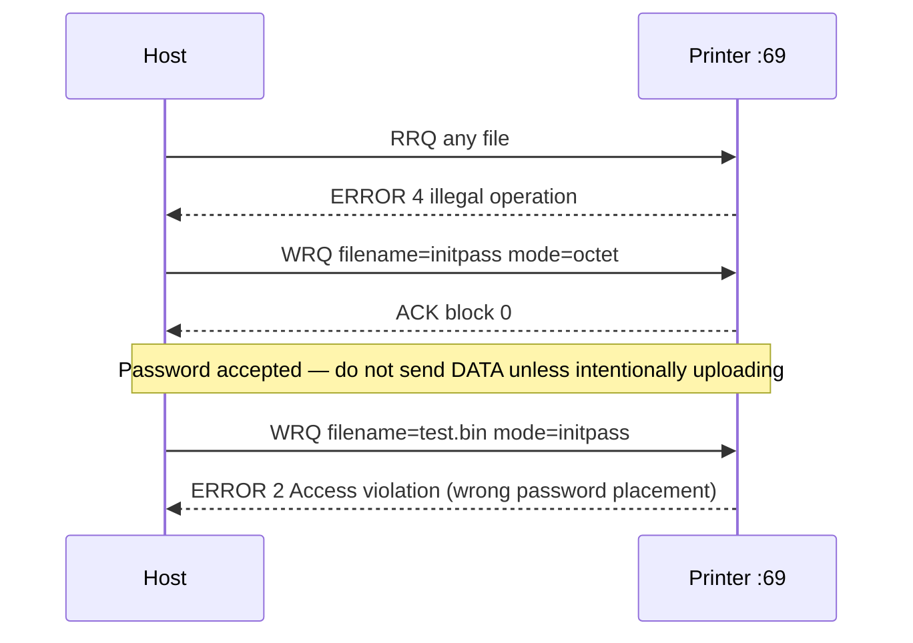
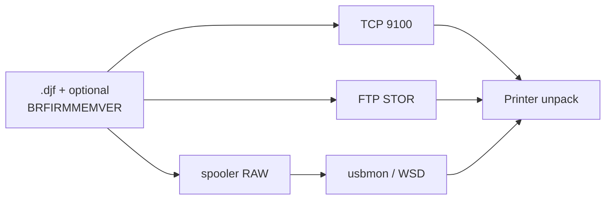

# Brother MFC-9330CDW

Research notes for the **MFC-9330CDW** color laser MFP used in this workspace.
Firmware blobs and fetch tooling are documented under
[`downloads/firmware/blobs/`](../downloads/firmware/blobs/README.md).

## Device

| | |
| --- | --- |
| Product | Brother MFC-9330CDW |
| Class | Color laser multifunction (print / scan / copy / fax) |
| CPU (service manual) | **StarSapphire 333 MHz** (Brother SoC name; ISA **likely ARM** — [HARDWARE-AND-BOOT.md](HARDWARE-AND-BOOT.md)) |
| Main PCB | **B57T054** / DCLFB (`LT2284001` / `D00EFW001`) |
| RAM | Service manual **256 MB**; this unit Web UI **192 MB** (confirmed 2026-10-25) |
| Network card | **NC-8500h** (wired 10/100, active); wireless NC-8100w present but inactive |
| LAN (this unit) | `192.168.1.71` · MAC `3c:2a:f4:35:90:5f` · node `BRN3C2AF435905F` |
| Windows printers seen locally | `Brother MFC-9330CDW Printer` (USB001), IPP/WSD copy |
| Serial (this unit) | `U63480K7J492832` |
| Live ROM (2026-10-25) | MAIN **ZC** · SUB1 **1.10** · SUB2 **R2311081800** · PJL `Ver.ZC` |
| Firmverup `NAME` | `MFC-9330CDW` |
| Firmverup `SPEC` (this unit / US-EU docs) | `0401` |
| Support product key | `mfc9330cdw_us_eu_as` |
| Official support | [Brother downloads](https://support.brother.com/g/b/downloadlist.aspx?c=us&lang=en&os=7&prod=mfc9330cdw_us_eu_as) |

Live snapshot detail: [`downloads/firmware/meta/live-inventory-2026-10-25.md`](../downloads/firmware/meta/live-inventory-2026-10-25.md).

Related SKUs in the same color-laser family (**B57T054 / DCLFB**) often share
MAIN firmware (payload identity `MFC-9130USA`). Platform / boot / Ghidra prep:
[`HARDWARE-AND-BOOT.md`](HARDWARE-AND-BOOT.md). Spare-board SPI session:
[`SPI-DUMP-CHECKLIST.md`](SPI-DUMP-CHECKLIST.md).

## Firmware categories (vendor)

Brother’s updater advertises several firm slots. For **SPEC `0401`** only some
return a download `PATH`:

| Category | Role (practical) | Available for 9330 / 0401 |
| --- | --- | --- |
| **MAIN** | Main controller firmware (`PROGRAM=FIRM`) | Yes — ZC |
| **SUB1** | Sub / PCL-related package | Yes — 1.10 |
| **SUB2** | Panel firmware | Yes — R |
| **IFAX** | Internet fax stub (`PROGRAM=IFAX`) | Yes — tiny |
| PCLPS, ENGINE, SUB3–5, BRNET | Other slots | No (`VERSIONCHECK=2`) |

Official support page labels the current combo roughly as **Main ZC / Sub 1.10 / Panel R**,
matching the three large blobs we pulled.

## How firmware is obtained

The Windows **Firmware Update Tool** (`BrMain4905` / `FirmwareUpdater.exe`) is a
**generic online client**. It does not embed model firmware. It:

1. Talks to `firmverup.brother.co.jp` (`verCheck` / `fileUpdate`).
2. Sends model `NAME`, regional `SPEC`, and current firm versions.
3. Receives `VERSIONCHECK` + optional `PATH` to an Akamai `.djf`.
4. Downloads that file and sends it to the printer (USB/network / PJL download).

Independent client used here: [`brother-firmware`](https://github.com/b1tninja/brother-firmware)
(and the local `tools/firmverup` prototype) — now also **`probe`** / **`upload`**
(JetDirect 9100 + FTP).

```text
VERSIONCHECK 0  → update available (PATH present)
VERSIONCHECK 1  → already current
VERSIONCHECK 2  → rejected / no package for this NAME+SPEC+category
```

Working request shape for this model:

- `NAME=MFC-9330CDW`
- `SPEC=0401`
- `DRIVER=EWS`
- User-Agent `BrHttpc/1.00`
- A real-looking older `VERSION` (e.g. `B0000000000` or archival `R1506121801:4504`)

## Local artifacts

| Path | Contents |
| --- | --- |
| [`downloads/firmware/`](../downloads/firmware/) | Official Firmware Update Tool installer |
| [`downloads/firmware/blobs/`](../downloads/firmware/blobs/) | Fetched `.djf` packages + inventory |
| [`downloads/firmware/blobs/binwalk/`](../downloads/firmware/blobs/binwalk/) | Binwalk logs + carved payloads |
| [`downloads/`](../downloads/README.md) | Broader support download tree (drivers, manuals, …) |
| [`tools/firmverup/`](../tools/firmverup/) | Early Python firmverup RE helpers |
| [`tools/brother_oids.py`](../tools/brother_oids.py) | Brother PEN 2435 OID pack (`register_pack` into snmpy; vendor-local) |
| [`tools/snmp_admin_probe.py`](../tools/snmp_admin_probe.py) | Admin challenge OIDs via [snmpy](https://github.com/b1tninja/snmpy) |
| [`tools/brcrypt_confirm.py`](../tools/brcrypt_confirm.py) | Offline `MakeConfirmPasswordValue_ver1` (60-byte SNMP confirm) |
| [`tools/brcrypt_snmp_set.py`](../tools/brcrypt_snmp_set.py) | Live GET challenge + SET confirm (`SetCommunity=internal`) |
| [`tools/telnet_show_inventory.py`](../tools/telnet_show_inventory.py) | Read-only Telnet `SHOW` / `HELP` dump → `Local>` |
| [`tools/brscan_probe.py`](../tools/brscan_probe.py) | Network scan `:54921` lease + `--scan` / `--extract-only` (JPEG · planes · PackBits) |
| [`tools/snmp_surface_probe.py`](../tools/snmp_surface_probe.py) | Broader SNMP walk (MIB-2 / Printer-MIB / Brother firm) |
| [`tools/snmp_scan_printers.py`](../tools/snmp_scan_printers.py) | LAN printer discovery + inventory (v2c sweep, v3 probe, GET/GETNEXT only) |
| [`tools/snmp_v3_loopback_check.py`](../tools/snmp_v3_loopback_check.py) | Self-contained SNMPv3/USM check vs an in-process agent (no device needed) |
| [`tools/snmp_brother_deep.py`](../tools/snmp_brother_deep.py) | Deep Brother `…2435.2.4.3` + supplies (GET/GETNEXT only) |
| [`tools/http_dump_authed.py`](../tools/http_dump_authed.py) | Web login (`Nfa=initpass`) + dump admin/network pages |
| [`tools/http_login_forms.py`](../tools/http_login_forms.py) | Discover login form field names |
| [`tools/telnet_login_probe.py`](../tools/telnet_login_probe.py) | NC-8500h Telnet → `Local>` (`initpass`; false-`#` pitfall fixed) |
| [`tools/net_surface_*.py`](../tools/) | Telnet / TFTP / auth experiments |
| [`tools/net_surface_smb_pjl.py`](../tools/net_surface_smb_pjl.py) | SMB listen check, PJL FS/DINQUIRE/ECHO, mDNS browse |
| [`tools/net_surface_ipp_lpd.py`](../tools/net_surface_ipp_lpd.py) | IPP `:631` Get-Printer-Attributes + LPD `:515` queue state |

## Re-download

```powershell
cd d:\code\brother-firmware
.\.venv\Scripts\python.exe -m brother_firmware download-all `
  --model MFC-9330CDW --spec 0401 `
  --out-dir d:\code\mfc9330cdw\downloads\firmware\blobs `
  --skip-existing
```

## Updater handling of the `.djf` (Ghidra / `FirmwareUpdater.exe`)

Investigated in Ghidra (`FirmwareUpdater.exe`, x86). Short answer: the Windows
tool **does not verify signatures or parse the image into upload segments**.
The CDN file is treated as an opaque job stream.

| Stage | Function | Behavior |
| --- | --- | --- |
| Download | `CBrInet::GetUpdateFile` → `FUN_004040f4` @ `004040f4` | HTTP `GET` of `FirmUpdateInfo.PATH`; write raw bytes to `data.dat` in 0x400 chunks. No hash/signature check. |
| Optional PJL prep | `Proc30USB` / `Proc30Net*` | If XML `MEMORYVERSION` is non-empty, build `data2.dat` with `@PJL SET BRFIRMMEMVER="%s"` and send that first via `DataOutput`. |
| Upload (USB) | `CBrPdr::DataOutput` @ `00409100` | Opens `data.dat`, sends whole file (`param_3 == NULL` → **no** extra UEL wrap). |
| Upload (net) | `CBrNetPr::DataOutput` @ `00406c20` | Same file, 1 KiB `Read` + `SyncSend` loop — dumb pipe. |
| UEL helper | `CBrPdr::MakeDataOutputFile` @ `00409350` | Can prepend `%c%-12345X%s\r\n` when given a PJL body string; used for small command jobs (`data2.dat`), not for carving the firmware. |

Crypto present in the binary (`SHA1`, `EncryptAES_ECB` via `BrCrypt.dll`) is only
wired into `CCryptedPasswd::MakeConfirmPasswordValue_ver1` (admin password
challenge), **not** firmware authentication. No `BRDOWNLOAD` / `PROGRAMLENG` /
`segment` / `checksum` strings in the updater — those live inside the
server-built `.djf`, which the printer consumes.

### Factory admin password (Web / BRAdmin / FTP / updater dialog)

You may never have set one — SNMP still reports a password as “configured”
because the factory default is present. Brother’s FAQ for this model
([faq00002496](https://support.brother.com/g/b/faqend.aspx?c=us&faqid=faq00002496_002&lang=en&prod=mfc9330cdw_us_eu_as)):

| Default | When |
| --- | --- |
| **`initpass`** | No **Pwd** sticker on the back/bottom |
| Label after **Pwd** | Sticker present (also printable on Network Configuration Report) |
| **`access`** / rarely **`admin`** | Older firmware / regional leftovers |

**This unit:** Web login and TFTP WRQ auth accept **`initpass`**; `access` /
`admin` fail for HTTP. Same string is intended for BRAdmin, network Remote
Setup, Firmware Update Tool admin dialog, and **FTP username** (FTP password
empty).

## Network surface (this unit)

Surveyed on LAN IP `192.168.1.71` (community `public`). Big picture: CDN
download is separate from LAN delivery; BrCrypt only gates **admin certify**,
not the `.djf` pipe.



### Listening services / protocols

From FTP `CFG-PAGE.TXT` (Network Configuration) and port probe — **Enabled**
unless noted:

| Service | Port / notes | RE value |
| --- | --- | --- |
| Web Based Management | TCP **80** (HTTPS present; no device cert) | Status, counters, settings UI |
| SNMP | UDP **161** `public` | Firm versions, supplies, admin challenge |
| Raw / JetDirect | TCP **9100** | Firmware / PJL job pipe |
| FTP | TCP **21** | `CFG-PAGE.TXT`; firm `STOR` (admin ID) |
| IPP | TCP **631** | Listener up; app-level empty reply (see IPP/LPD) |
| LPD | TCP **515** | Queue-state OK; no auth (see IPP/LPD) |
| WSD / Web Services | — | Windows WSD queue |
| Network scan / PC-fax | TCP **54921** (mDNS `_scanner`; brscan pull) · PC-fax Enabled | Host connectors; not SMB. Brother firewall docs also list **UDP 54925/54926** (host-listen / push); null probe → no reply; TCP those ports closed |
| Remote Setup | No dedicated TCP port | Vendor docs: **UDP 137 + 161** (NetBIOS + SNMP / BRAdmin). USB **MI_02** SIB for local. Telnet has no `SHOW REMOTE*` noun |
| Telnet | TCP **23** | NC-8500h Command Console → `Local>` with **`initpass`** (see Telnet section) |
| TFTP | UDP **69** | **WRQ only**; password is the **remote filename** (see below). RRQ → “illegal operation” |
| CIFS | Enabled (CFG) | **Client only** — no TCP **445/139** listener; no shares to enum (see below) |
| mDNS / LLMNR / NetBIOS | Enabled | Discovery (`Brother MFC-9330CDW` / `BRN3C2AF435905F.local`) |
| POP3/SMTP | Enabled (servers `0.0.0.0`) | Unused until configured |
| Proxy / Brother Online | Disabled | — |

```powershell
# Ports + local queues
cd d:\code\brother-firmware
.\.venv\Scripts\python.exe -m brother_firmware probe 192.168.1.71
# SNMP helpers (snmpy = RFC packs only; Brother pack is tools/brother_oids.py)
cd d:\code\mfc9330cdw
python -m snmpy --import tools.brother_oids packs
python -m snmpy --import tools.brother_oids get --pack brother --hex 192.168.1.71 challenge
python tools\snmp_admin_probe.py 192.168.1.71
python tools\snmp_surface_probe.py 192.168.1.71
python tools\snmp_brother_deep.py 192.168.1.71
# Find the printer on the LAN (auto-detects local subnet; no device IP needed)
python tools\snmp_scan_printers.py --expect MFC-9330CDW
python tools\snmp_scan_printers.py -s 192.168.1.0/24 --all --json -
# SNMPv3/USM against a device with a configured user (or --v3-probe for engine IDs)
python tools\snmp_scan_printers.py -t 192.168.1.71 --v3-user admin -U authpass -A SHA -X privpass
python tools\snmp_v3_loopback_check.py        # validates the v3 stack with no hardware
# Network config text via FTP
# RETR CFG-PAGE.TXT  (anonymous list worked on this unit; STOR firm still wants admin ID)
# Authenticated web dump helpers
python d:\code\mfc9330cdw\tools\http_dump_authed.py
python d:\code\mfc9330cdw\tools\net_surface_smb_pjl.py 192.168.1.71
python d:\code\mfc9330cdw\tools\net_surface_ipp_lpd.py 192.168.1.71
```

### CIFS / SMB (read)

CFG lists **CIFS Enabled**, but this unit is **not** an SMB server:

| Check | Result |
| --- | --- |
| TCP **445** / **139** | Closed / filtered (timeout) |
| `net view \\192.168.1.71` | System error 53 (path not found) |
| Anonymous / guest share enum | N/A — nothing listening |
| NetBIOS UDP 137 | Name `BRN3C2AF435905F` types `<00>` + `<20>` registered (MAC matches); `<20>` alone ≠ TCP file share |
| mDNS `_smb._tcp` | Not advertised |

Practical meaning: CIFS here is the **client** path for Store Print Log
(`/admin/logtonet.html` — Kerberos/NTLMv2 to a *remote* share), not a host
share surface for RE. No passwords or filesystem via SMB on the printer.

### SNMP (read)

| OID / tree | Content (live) |
| --- | --- |
| `sysDescr` | `Brother NC-8500h, Firmware Ver.1.22 (23.02.14), MID 8CE-415, FID 2` |
| `sysName` | `BRN3C2AF435905F` |
| Printer-MIB serial | `U63480K7J492832` |
| Printer-MIB supplies | K/C/M/Y toner, waste, belt, 4× drum (levels below) |
| Brother firm walk `…99.3.1.6.1.2` | `MODEL` / `SPEC=0401` / `MAIN=ZC2311081154:886F` / `SUB1=1.10` / `SUB2=R2311081800` |
| `…2435.5.100.1.1.0` | `01` — password present (often still factory default) |
| `…2435.5.100.10.1.0` | **20-byte challenge** (changes every GET) |
| `…2435.5.100.10.2.0` | Confirm SET target (empty on GET); SET needs community **`internal`** |
| `…2435.5.100.10.3.0` | Also empty on GET (sibling of confirm — treat as write-ish) |

#### LAN discovery (`tools/snmp_scan_printers.py`, live)

Sweeps a subnet with read-only SNMPv2c (`sysDescr` + `sysObjectID`), then
enriches what classifies as a print device. Output of a real /24 run:

| Field | Value |
| --- | --- |
| Address | `192.168.1.71` (only SNMP responder on the subnet, 20 s / 254 addrs) |
| Model | `MFC-9330CDW` — from the IEEE 1284 device ID (`MDL:`), not `sysDescr` |
| `sysDescr` | `Brother NC-8500h, Firmware Ver.1.22 (23.02.14), MID 8CE-415, FID 2` |
| Serial | `U63480K7J492832` (Printer-MIB `prtGeneralSerialNumber`) |
| Pages | `25,258` (`prtMarkerLifeCount`) |
| Classification | IEEE 1284 ID + `hrDeviceType = hrDevicePrinter` + Printer-MIB objects |
| Non-SNMP hosts | TCP 9100/515/631 fallback — `192.168.1.71` alone exposes all three |

Notes that matter when re-using it:

* `sysDescr` names the **NC-8500h print server**, not the MFC model — the
  scanner prefers the `MDL:` field of Brother's 1284 ID string.
* `prtMarkerSuppliesLevel` is raw; the table prints `level/max_capacity`
  (toner 253/254, belt 43119/50000, drums 5377/15000).
* Nothing is ever SET — Brother's `admin100` confirm tree is write-only and
  challenge-based, so discovery stays on GET/GETNEXT.
* v3 needs a USM user configured on the device; `--v3-probe` alone only
  harvests authoritative engineIDs (`BRN…` embeds the MAC, e.g.
  `…3c2af435905f` ↔ `3c:2a:f4:35:90:5f`).

#### Brother enterprise deep walk (`1.3.6.1.4.1.2435`, live)

Only child under enterprise is **`.2`**. Under `.2`: **`.3`** (IEEE 1284 / PJL device-ID) and **`.4.3`** (main MFP/net tree). Under **`…2.4.3`** immediate children:

| Branch | Role (observed) |
| --- | --- |
| `.1` / `.6` / `.7` / `.13` | Tiny flags / counters |
| **`.99`** | Device tables: trays, duplex `DXTYPE=US`, RAM `DIMM 196608` KiB-ish, **firm ID strings**, placeholder email `brn…@example.com` |
| **`.100`** | Wireless / 802.1X catalog (`opensystem`…`wpa2-psk`, `eap-fast*`) — large; many empty credential slots |
| **`.1240`** | NC-8500h identity: node `BRN3C2AF435905F`, net firm `1.22`, card `Brother NC-8500h`, community string **`public`** at `…1240.1.15.0`, display `Sleep` |
| **`.2435.5`** | Fat vendor bag (~34 subtrees): model name, panel/UI limits (`.45` touch 3.7″), **LDAP/addr-book attrs** (`.19` includes `facsimileTelephoneNumber`), **admin100** challenge |
| **`.2435.10` / `.20`** | Smaller opaque tables |

Sibling **`…2435.2.3.9.1.1.7.0`**: full 1284 ID (`MFG:Brother;…MDL:MFC-9330CDW;…URF:…`).

**Writable-looking (GET-empty / known SET; no SET done):** `…5.100.10.2.0` (confirm), `…10.3.0`; empties under `…5.36.*`, Wi-Fi PSK-ish `…100.1.11.11.1.2.*`, LDAP value slots `…5.19.22…`; `…1240.1.15.0` exposes community `public` (likely also settable with a write community — not tested).

**Printer-MIB consumables** (`prtMarkerSupplies*`, marker life ≈ **25257**):

| # | Description | type | max | level | note |
| --- | --- | --- | --- | --- | --- |
| 1–4 | K/C/M/Y Toner | 3 | 254 | 253 | Brother 0–255-ish gauge |
| 5 | Waste Toner Box | 4 | 254 | 253 | |
| 6 | Belt Unit | 1 | 50000 | 43131 | impressions |
| 7–10 | K/C/M/Y Drum | 9 (OPC) | 15000 | 5378 | impressions |

**Fax / scan via SNMP:** no standard Fax-MIB; Host-Resources shows a single **printer** device only. Fax-ish content is proprietary — LDAP attribute name `facsimileTelephoneNumber` under `…2435.5.19`, not live fax counters. No obvious “scan” string leaves under `2.4.3` in these walks.

```mermaid
sequenceDiagram
  participant Tool as Updater / RE tool
  participant Prn as Printer SNMP
  participant Crypt as BrCrypt.dll
  Tool->>Prn: GET …100.1.1.0 (pwd set?)
  Prn-->>Tool: 01
  Tool->>Prn: GET …100.10.1.0 (challenge)
  Prn-->>Tool: 20-byte nonce
  Tool->>Crypt: MakeConfirmPasswordValue_ver1(pwd, challenge)
  Note over Crypt: SHA1-heavy; AES export loaded but unused in ver1
  Crypt-->>Tool: 60-byte confirm
  Tool->>Prn: SET …100.10.2.0 (confirm)
  Note over Tool,Prn: Unlocks admin path — not DJF decrypt
```

#### `MakeConfirmPasswordValue_ver1` algorithm (Ghidra @ `0040c880`)

Recovered from `FirmwareUpdater.exe` + `BrPdr\BrCrypt.dll` (`SHA1` export;
`EncryptAES_ECB` is `GetProcAddress`’d but **never called** in ver1).

Inputs: ASCII password (max 32 chars copied into a local buffer), 20-byte
SNMP challenge `C`. Host also draws 20 random bytes `rand` via
`CryptGenRandom`.

```text
P = SHA1(password)           # 20 bytes; strlen, no NUL
R = SHA1(rand)               # 20 bytes; client nonce
M = SHA1(R || C || P)        # 20 bytes over a 60-byte staging buffer

confirm (60 bytes) =
  C[0:20]  ||  R[0:20]  ||  M[0:20]
```

Staging buffer hashed for `M` (not sent): `[0:20]=R`, `[20:40]=C`, `[40:60]=P`.
Wire layout echoes `C` first so the printer can bind the SET to the challenge
it issued, then checks `M` against its stored password hash.

Python: [`tools/brcrypt_confirm.py`](../tools/brcrypt_confirm.py)
(`make_confirm_password_value_ver1` / `verify_confirm_offline`).

**Live-verified on this unit:** GET challenge (`public`) → build confirm →
SNMP SET `…10.2.0` with Telnet-reported **`SetCommunity=internal`** →
`error_status=0`. Same SET with community `public` → `error_status=6`
(noAccess). Helper: [`tools/brcrypt_snmp_set.py`](../tools/brcrypt_snmp_set.py).

When `…100.1.1.0` says no password is set, `Certify` falls back to SET
`1.3.6.1.4.1.1240.2.3.4.1.6.0` with the password octets (separate path).

### HTTP Web UI

Unauthenticated GETs return the chrome + public status; many admin/network
pages redirect to a **Login** form. Banner still nudges “Please configure the
password”.

**Login (confirmed `initpass` on this unit):**

```http
POST /general/status.html
Nfa=<password>&loginurl=/net/net/protocol.html
→ Set-Cookie: AuthCookie=… ; redirect to loginurl
```

Field name is **`Nfa`** (not `password`). Wrong password →
`/etc/loginerror.html` → `/etc/passerror.html`. Success shows **Logout** and
unlocks Administrator / Network settings.

Useful without login:

| Path | Notes |
| --- | --- |
| `/general/status.html` | Landing / status / toner bars |
| `/general/information.html?kind=item` | Model, serial, MAIN/SUB versions, **page/image/drum counters**, remaining life |
| `/net/net/net.html` | Wired + wireless node names / MACs (partially public) |

After login (`AuthCookie`):

| Path | Notes |
| --- | --- |
| `/net/net/protocol.html` | Toggle list: HTTP, Telnet, SNMP, Remote Setup, LPD, Raw Port, IPP, AirPrint, Web Services, GCP, Proxy, Network Scan, PC-Fax, POP3/SMTP, **FTP**, **TFTP**, CIFS, mDNS, LLMNR, SNTP |
| `/net/net/snmp.html` | SNMPv3 / certificate gate page |
| `/admin/password.html` | Change login password |
| `/admin/default.html` | Reset Menu (Network / Address Book & Fax / All Settings) |
| `/admin/lock.html` | Secure Function Lock (off) |
| `/admin/settinglock.html` | Setting Lock (off) |
| `/admin/logtonet.html` | Store print log to network (CIFS/Kerberos/NTLMv2) |

Helpers: [`tools/http_dump_authed.py`](../tools/http_dump_authed.py),
[`tools/http_login_forms.py`](../tools/http_login_forms.py).

### FTP

Banner: `FTP print service:V-1.13/Use the network password for the ID if updating.`

On this unit, **LIST** / `RETR CFG-PAGE.TXT` succeeded with `anonymous`,
`initpass`, `access`, and `admin` (empty FTP password). Treat **firmware
`STOR`** as the operation that needs the real admin password as username.
`CFG-PAGE.TXT` is the same Network Configuration report (protocols, IP, MAC,
services).

### TFTP



Brother quirk: the **WRQ filename is the network password**; mode stays
`octet`. Classic CLI shape: `tftp> put local.bin initpass`. RRQ is rejected.
We verified ACK for `initpass` and **did not** send a data payload.

### Telnet (NC-8500h Command Console)

**Works with `initpass`.** Earlier probes failed because the welcome line
contains the substring `at # prompt`, so waiting for `b"# "` matched the
*instructions* and sent the password before Return.

```text
→ CRLF                         # first Return (required)
← BEL CRLF "# "
→ "initpass" CRLF              # password does not echo
← Brother NC-8500h Command Console …
   Enter username>
→ CRLF                         # empty username OK
← Local>
```

`access` / `admin` → BEL + `#` again. From `Local>`: `HELP`, `SHOW`,
`SHOW SERVER` (read-only). Avoid `SET` / `INIT` / `CLEAR` / `ZERO`.

`SHOW SERVER` (live): node `BRN3C2AF435905F`, MAC `3c-2a-f4-35-90-5f`,
**2 Mbyte Flash** on the print server, password limit 5, 100baseTX FDX.

Notable `SHOW` (read-only inventory; avoid `SET`/`INIT`):

| Command | Highlight |
| --- | --- |
| `SHOW SNMP` | `GetCommunity=public` · **`SetCommunity=internal`** |
| `SHOW FREE` | APP heap ~2.3 MiB total / ~1.2 MiB free; OS heap 150 KiB |
| `SHOW IP` | DHCP `192.168.1.71`; service → TCP **9100** |
| `SHOW SERVICE` | `BINARY_P1` / `TEXT_P1` / `POSTSCRIPT_P1` / `PCL_P1` / … on P1 |
| `SHOW IPP` | Enabled; URLs `:631/`, `/ipp`, `/ipp/port1`, `/brn…`, `/binary_p1`, `/text_p1`, `/postscript_p1`, `/pcl_p1`, `/brn…_at` |
| `SHOW LPD` | **Enabled** (no further params) |
| `SHOW VERSION` | NC-8500h Ver.1.22; protocol list matches CFG-PAGE |
| `SHOW LOAD` | **Firmware load is Disabled** (TFTP/host load params empty) |
| `SHOW PORT` | P1 “Parallel” bridge; status Sleep / waiting for data |
| `HELP SHOW` | Also: `LOAd`, `NETSCan`, `PCFAX`, `REMOTESEtup`, `RAWPort`, … |

Probes: [`tools/telnet_login_probe.py`](../tools/telnet_login_probe.py),
[`tools/telnet_show_inventory.py`](../tools/telnet_show_inventory.py).
Captures under `downloads/firmware/meta/telnet-show*.txt` (local).

### PJL over TCP 9100 (read)

`@PJL INFO *` works without password:

| Command | Live sample |
| --- | --- |
| `INFO ID` | `"Brother MFC-9330CDW:8CE-415:Ver.ZC"` |
| `INFO STATUS` | `CODE=40000` · `DISPLAY="Sleep"` · `ONLINE=TRUE` |
| `INFO CONFIG` | trays / papers / `PCL`+`POSTSCRIPT`+`PCLXL` · `MEMORY=201326592` |
| `INFO MEMORY` | `TOTAL=66619584` (largest free ≈64 MiB) |
| `INFO VARIABLES` | full print env; `PASSWORD=DISABLED` (PJL lock, not web admin) |
| `INFO PAGECOUNT` | `PAGECOUNT=25257` (this unit) |
| `ECHO …` | Echoes the token (supported) |
| `DINQUIRE PASSWORD` | `DISABLED` (same PJL lock bit; **not** web/`initpass`) |
| `DINQUIRE TIMEDATE` | `"?"` (unsupported) |
| `DINQUIRE COPIES` | `1` |
| `INFO FILESYS` / `PRODINFO` / `DIRTYDISK` | `"?"` — **no PJL mass-storage / filesys** |
| `FSQUERY` / `FSDIRLIST` (`0:`/`1:`/`2:`, incl. `..\passwords`) | **Empty** — filesystem PJL not implemented (no RE FS / pwd dump here) |

Helper: [`tools/net_surface_smb_pjl.py`](../tools/net_surface_smb_pjl.py).

### IPP / LPD (read)

Both advertised **Enabled** (`SHOW IPP` / `SHOW LPD`) and listening. Live
probe: [`tools/net_surface_ipp_lpd.py`](../tools/net_surface_ipp_lpd.py).

#### IPP (TCP **631**)

| Check | Live result |
| --- | --- |
| TCP listen | Open |
| `SHOW IPP` URLs | `/`, `/ipp`, **`/ipp/port1`**, `/brn3c2af435905f`, `/binary_p1`, `/text_p1`, `/postscript_p1`, `/pcl_p1`, `/brn3c2af435905f_at` (+ hostname forms) |
| mDNS `rp=` | **`ipp/print`** (≠ SHOW path `/ipp/port1`) |
| HTTP GET (those paths) | TCP accept → **empty reply** (no status line; curl exit 52) |
| `Get-Printer-Attributes` POST `application/ipp` | Same empty reply (IPP 1.0/1.1/2.0; with/without Basic `admin:initpass`) |
| TLS on 631 | EOF / not HTTPS |
| Auth challenge | **None** (no `WWW-Authenticate`, no IPP `client-error-not-authenticated`) |
| Ops / `document-format-supported` | **Unavailable** via IPP (daemon never returns a body) |

PDL / RAW / DJF from **Bonjour** (fallback while IPP attrs are dead):

| Source | Claim |
| --- | --- |
| mDNS `pdl=` | `application/octet-stream`, `image/urf`, `image/pwg-raster` |
| mDNS `usb_CMD=` | `PJL,PCL,PCLXL,URF` |
| mDNS `Binary=` | `T` |
| DJF / firmware MIME | **Not** advertised |

So Bonjour claims a **RAW-ish** (`octet-stream`) + AirPrint raster path; nothing
DJF-shaped. CUPS/IPP ops cannot be confirmed on the wire until the empty-reply
behavior is understood (stub listener vs. sleep/firmware quirk).

#### LPD (TCP **515**)

| Check | Live result |
| --- | --- |
| TCP listen | Open |
| Auth (queue state) | **None** — opcodes **03/04** answer immediately |
| mDNS queue `rp=` | `duerqxesz5090` |
| Queue state text | `Printer Name: <q>\nJobs: No Jobs in Queue\n` (short ≡ long here) |
| Named queues tried | `duerqxesz5090`, `BINARY_P1`, `TEXT_P1`, `POSTSCRIPT_P1`, `PCL_P1`, `BRN3C2AF435905F`, plus invented `lp` / `raw` / empty — **all** echo the requested name (no reject on status) |
| Banner / type | `SHOW IP`: LPD banner **Disabled**, type **TYPE1**, retry Enabled |
| Opcode **02** receive-job | **Not** probed (would submit a job) |

LPD does not advertise MIME types; mDNS `_printer._tcp` uses the same `pdl=` /
`usb_CMD=` as IPP. Whether a RAW/PJL/DJF stream is accepted on 515 is untested
(read-only). Firm upload remains the documented **9100 / FTP** paths.

### mDNS / Bonjour

Hostname `BRN3C2AF435905F.local` → `192.168.1.71`. Service name
`Brother MFC-9330CDW`. Advertised types (no `_smb`):

| Type | Port | Notes |
| --- | --- | --- |
| `_ipp._tcp` | **631** | `rp=ipp/print`; `pdl=application/octet-stream,image/urf,image/pwg-raster`; `usb_CMD=PJL,PCL,PCLXL,URF`; UUID `e3248000-80ce-11db-8000-3c2af435905f` |
| `_printer._tcp` | **515** | LPD; queue `rp=duerqxesz5090`; same `pdl=` / `usb_CMD=` |
| `_pdl-datastream._tcp` | **9100** | Raw / JetDirect; same `pdl=` (TBCP=`T`) |
| `_http._tcp` | **80** | Web UI |
| `_scanner._tcp` | **54921** | Brother network scan; feeder+flatbed+button |

### Network scan (TCP **54921**, brscan)

Same family as open brscan2/4 / [freethescan](https://github.com/sylvinus/freethescan)
notes — **no auth**. Framing:

```text
← +OK 200\r\n          # ready (−NG 401 = busy)
→ \x1b I \n R=dpi,dpi \n M=mode \n \x80     # capability / “lease”
← \x00 <len> \x00 dpiX,dpiY,adf,mmX,pxX,mmY,pxY,\x00
→ \x1b X \n R=… \n M=… \n C=JPEG|RLENGTH|NONE \n … \n A=x1,y1,x2,y2 \n \x80
← chunked image … `0x82` (end page) / `0x80` (end scan)
```

**Chunk framing** (12 B little-endian length at `+10`):

| Off | Field | Live values |
| ---: | --- | --- |
| `0` | type | `0x40` 1bpp TEXT / 8bpp GRAY64 · `0x42` packed RLENGTH · `0x44`/`0x48`/`0x4c` CGRAY planes · `0x64` JPEG · `0x80`/`0x82` end |
| `1` | const | `0x07` |
| `2..3` | const | `00 01` |
| `4..5` | const | `00 84` |
| `6..7` | `u16le` width hint | JPEG ≈ crop+pad (`416` for 400); else `0` |
| `8..9` | `0` | |
| `10..11` | `u16le` payload len | JPEG = JFIF size; TEXT/`0x40` ≈ `width//8` (1bpp) or `width` (8bpp); `0x42` = compressed size |

End markers are **chunk types** at a frame boundary — raw `0x80` inside plane
pixels must not stop the read (`brscan_probe` parses headers for EOF).

Live lease (this unit, flatbed; `adf=2`):

| Request | Offer |
| --- | --- |
| `R=100,100` `M=CGRAY` | `100,100,2,209,826,291,1145` |
| `R=300,300` `M=TEXT` / `CGRAY` / `GRAY64` | `300,300,2,209,2480,291,3437` |

Modes tried: `CGRAY`, `GRAY64`, `TEXT`. Live **`X` scan** matrix (this unit,
2026-10-25) @ 100 DPI, crop **100²** (`--max-px 100`), brief retry on `-NG 401`:

| Mode \\ `C=` | `JPEG` | `RLENGTH` | `NONE` |
| --- | --- | --- | --- |
| **CGRAY** | OK → `.jpg` (`0x64`) | OK → `.ppm` (`0x44`/`0x48`/`0x4c`) | OK → `.ppm` (same planes as RLENGTH) |
| **GRAY64** | OK → `.jpg` (`0x64`, gray JFIF) | OK → `.pgm` (`0x42` PackBits) | OK → `.pgm` (`0x40` × 100 B 8bpp) |
| **TEXT** | **fail** (0 B body) | OK → `.pbm` (`0x42` PackBits) | OK → `.pbm` (`0x40` 1bpp) |

**`0x42` PackBits** (same as [sane-devel 2001](https://alioth-lists.debian.net/pipermail/sane-devel/2001-August/039855.html)):
`x ≤ 0x80` → copy next `x+1` bytes; `x > 0x80` → repeat next byte `257−x` times.
Verified offline: TEXT RLENGTH expands to match TEXT/NONE (99/100 rows identical;
1 dust pixel; RLE rows are `width//8` bytes, padded to `(width+7)//8` like NONE);
GRAY64 every row expands to crop width.

Earlier larger crops still hold: `TEXT`/`NONE` 400² → `.pbm`; `CGRAY`/`JPEG` 400² →
`.jpg`; `CGRAY`/`RLENGTH` 200² → `.ppm`.

```powershell
python tools\brscan_probe.py 192.168.1.71 --dpi 100 --mode TEXT --scan --compression NONE --max-px 100
python tools\brscan_probe.py 192.168.1.71 --dpi 100 --mode CGRAY --scan --compression JPEG --max-px 100
python tools\brscan_probe.py 192.168.1.71 --dpi 100 --mode GRAY64 --scan --compression NONE --max-px 100
python tools\brscan_probe.py --extract-only downloads\firmware\meta\brscan-cgray-jpeg.bin
python tools\brscan_probe.py --extract-only downloads\firmware\meta\brscan-text-rlength.bin --max-px 100
python tools\brscan_probe.py --extract-only downloads\firmware\meta\brscan-gray64-rlength.bin
```

Samples under `downloads/firmware/meta/brscan-*`. Helper:
[`tools/brscan_probe.py`](../tools/brscan_probe.py)
(`--all-modes` lease sweep; `--scan` crop; `--extract-only` offline decode
incl. `0x42` PackBits → `.pbm`/`.pgm`; `--max-px` crop size; busy `-NG 401`
retried a few times).

### Telnet extras (read-only, live)

| Command | Result |
| --- | --- |
| `SHOW NETSCAN` | `Network scan is Enabled` (no port field — use mDNS/`54921`) |
| `SHOW PCFAX` | `PC fax receive is Enabled` |
| `SHOW LOAD` | **Firmware load is Disabled**; empty Load Host / Software file (TFTP *pull* path off) |
| `SHOW FREE` | APP heap ~2.3 MiB total (~1.0 MiB free); OS heap 150 KiB |
| `SHOW SNMP` | `GetCommunity=public` · `SetCommunity=internal` · Legacy Auth Enabled |

### Delivering a `.djf` to this unit

| Path | How | Password? |
| --- | --- | --- |
| Network raw | TCP **9100** — send `.djf` (and optional `@PJL SET BRFIRMMEMVER` first) | No |
| Network FTP | `STOR` file; **FTP user = admin password**, empty FTP password | Admin pwd |
| USB / WSD | Windows spooler **RAW** against installed Brother queue (`USB001` / WSD) via `brother-firmware upload --method spooler` | No |



USB/WSD does **not** need BrCrypt or DJF unpack on the host. The queue object
(Brother printer driver) is required so Windows has something to `OpenPrinter`;
`RAW` bypasses `BRPRC12A` GDI rendering. Port monitor on this host is Microsoft
USB Monitor → `usbprint.sys`. See [`downloads/drivers/README.md`](../downloads/drivers/README.md).

```powershell
cd d:\code\brother-firmware
.\.venv\Scripts\python.exe -m brother_firmware probe 192.168.x.x
.\.venv\Scripts\python.exe -m brother_firmware probe local   # USB/WSD queues
.\.venv\Scripts\python.exe -m brother_firmware upload `
  --host 192.168.x.x `
  --file d:\code\mfc9330cdw\downloads\firmware\blobs\LZ4266_ZC_1.djf `
  --memver a   # dry-run; add --yes to send
# USB001 / WSD (needs maturin-built brother_firmware_native):
.\.venv\Scripts\python.exe -m brother_firmware upload `
  --method spooler `
  --file d:\code\mfc9330cdw\downloads\firmware\blobs\LZ3196_A.djf `
  --memver a   # dry-run; add --yes to send
```

`MEMORYVERSION` from firmverup (usually `a` for this model) becomes the
`BRFIRMMEMVER` preamble. Admin password / `BrCrypt` is unrelated to unpacking
the high-entropy body.

### Not visible on the network

DJF body codec and SPI flash layout — on-device / SPI dump only. USB composite
on this PID: **MI_00** USBPRINT (RAW firm-update), **MI_01** scan (`BrScnUsb`),
**MI_02** SIB Remote Setup (`BrUsbSib`/`BrSerIb`) — setup/status, **not** a
host DJF unpack path. See [`downloads/drivers/README.md`](../downloads/drivers/README.md)
and blob [`FORMAT.md`](../downloads/firmware/blobs/FORMAT.md).

Implication for RE: host-side tooling need only download + send the blob (plus
optional `BRFIRMMEMVER`). Parsing `PROG`/`ROM2`/`PANL` is a printer-side /
offline analysis problem, not something the updater does.

Bundled `res/BrPdr/BrPdrMai.exe` (Ghidra `/BrPdr`) is an older USB helper that
builds `@PJL DOWNLOADBR` (`REQUEST` / `START` / `PROGRAMWRITE` + `PROGRAMLENG` +
`DATA=`) around a firmware file and pipes it — still **no** body decrypt.
`Pack.exe` packs the updater installer (PDB path), not firmware.

Offline format progress: [`downloads/firmware/blobs/FORMAT.md`](../downloads/firmware/blobs/FORMAT.md).
**`hdr2[1]` looks like a flash/load high-water** — 9330 MAIN `LZ4266_ZC_1` →
`0x00f0857f` (just under **16 MiB**); MAIN-era also has `hdr2[6]=hdr2[1]+64/128KiB`.
MAIN-era letter XOR (`LZ2350_B`⊕`_L`) exposes a **774 KiB** band of **112 B
(16×7) frames** that is **period-7 Family-A** (counter lanes Δ `0x40`/`0x44`/`0x10`;
lane1 letter-XOR always `0xb0`) — same framing as PANL valley A, still not
plaintext ([`MAIN_XOR_112.md`](../downloads/firmware/corpus/MAIN_XOR_112.md);
`tools/djf_parse/main_xor_deep.py`). BH13 `LZ4228_P` map is ARM-shaped but its
`Compress=1` bulk (~`rom0+0x1ca048`) is not stock zlib. Best Ghidra size/end hint
once plaintext exists remains `hdr2[1]`. `.djf` bodies stay packed (no usable vectors/ELF). Path to binaries: **SPI NOR dump** of the main
PCB (sibling Brother work: 16 MiB SOP8 + `flashrom`), then load at `0` / SoC remap
with length ≈ `hdr2[1]`. Tool: `tools/djf_parse/hdr2_addrs.py`.
010 template: [`Brother_DJF.bt`](../downloads/firmware/blobs/Brother_DJF.bt) ·
MCP: [`010editor-mcp`](https://github.com/b1tninja/010editor-mcp).
